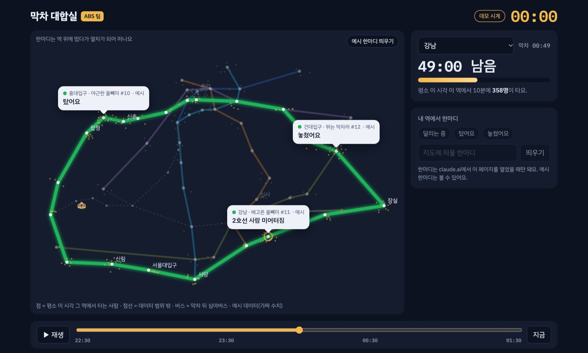
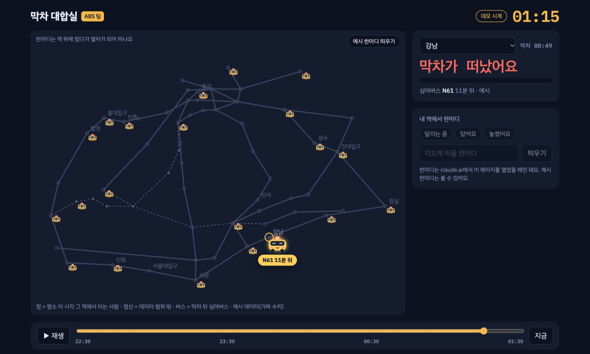

# 막차 대합실

SNU ABS 14기 데이터 시각화 팀프로젝트 레포지토리입니다.

밤 11시부터 새벽 1시 30분까지만 여는 서울 지하철 막차 지도.

시간이 지나면서 막차가 끝난 노선이 하나씩 꺼지고, 역마다 "평소 이 시각에 여기서 타는 사람"이 점으로 보인다.
내 역을 고르면 막차까지 남은 시간이 줄어들고, 익명으로 한마디를 남기면 지도 위에 잠깐 떴다가 열차가 되어 노선을 따라 떠난다.

> 지금은 **ABS 과정 팀원끼리만** 쓰는 버전부터 시작한다. 링크는 비공개, 팀원만 초대.
>
> 프로토타입이라 역 일부만 넣었고 좌표는 근사치, 막차 시각, 승차 인원, 심야버스 번호·배차는 **전부 가짜 숫자**다.

## 화면 (프로토타입, 가짜 데이터)

| 막차 전: 한마디가 역 위에 떴다가 열차가 되어 떠남 | 막차 뒤: 끊긴 역 옆에 심야버스 |
| --- | --- |
|  |  |

## 왜 만드나

- 막차 시각 조회는 카카오맵, 네이버지도에도 있다. 그런데 "지금 서울에서 어디가 먼저 끊기는지", "막차 직전에 사람이 어디 몰리는지"를 한눈에 보는 화면은 없다.
- 기존 서울 지하철 도달시간 지도는 평균 배차간격 기반이라 막차를 다루지 않는다.
- 카드 데이터에는 막차를 **탄 사람만** 남는다. 놓친 사람은 어디에도 기록되지 않는다. "놓쳤어요" 버튼으로 그 빈칸을 채워 보는 게 이 프로젝트에서 제일 해 보고 싶은 부분.

분위기는 "온라인 담타"에서 가져왔다. 정해진 짧은 시간, 같이 있는 느낌, 익명. 다른 점은 화면의 점이 접속자가 아니라 통계 속 승객이라는 것. 그래서 접속자가 0명이어도 대합실이 비어 보이지 않는다.

## 지금 되는 것

- 시간 슬라이더 / 재생: 22:30 ~ 01:30, 막차가 끝난 구간은 어둡게
- 역별 승객 점: 23시대·00시대 승차 인원 기준 (가짜 수치)
- 내 역 카운트다운: 막차 10분 전부터 빨간색, 막차가 떠나면 가장 가까운 열린 역 안내
- 막차가 끊긴 역 옆에 심야버스(N버스) 아이콘. 내 역이면 크게 뜨고 "N61 11분 뒤" 같은 표시, 내 역에 버스가 없으면 가장 가까운 정류장 역까지 점선
- 데이터 범위 밖 구간(코레일 1호선, 9호선 1단계)은 점선 회색
- 한마디: 역 위 말풍선 7초 → 작은 열차가 되어 노선을 따라 떠남, 그동안 그 노선만 강조
  - 동시에 3개까지, 같은 역은 하나씩
  - 60자, 3초에 한 번, 전화번호·욕설 일부 가림

## 실행

빌드 없음. 브라우저로 열면 된다.

```bash
open makcha-demo/index.html
```

채팅 저장은 claude.ai 아티팩트의 공유 저장소(`window.claude`)에 붙어 있어서, 로컬에서 열면 **예시 한마디만** 보인다. 실제 배포 때는 Supabase Realtime이나 Firebase로 바꿀 예정.

## 쓸 데이터 (예정)

| 데이터 | 출처 | 용도 |
| --- | --- | --- |
| 역·요일·방면별 열차 시간표 | 서울교통공사 (공공데이터포털) | 막차 시각, 도달 범위 계산 |
| 역별 막차 시간표 | 서울교통공사 | 검증용 |
| 호선별·역별·시간대별 승하차 인원 | [서울 열린데이터광장 OA-12252](https://data.seoul.go.kr/dataList/OA-12252/S/1/datasetView.do) | 역별 승객 점, 막차 직전 승차 추정 |
| 환승역 거리·소요시간 | 공공데이터포털 | 환승 포함 도달 계산 |
| 역 좌표 | 공공데이터포털 | 지도 |
| 심야버스(N버스) 노선·정류장·도착 정보 | 서울 열린데이터광장 / 서울 버스 API | 막차 뒤 대안 안내 |

확인 결과 (2026-11-17, `pipeline/check_sources.py`):
- 시간표 API에 열차번호가 온다
- 승하차 데이터에 23·0·1시 칸이 있다 (월 합계)
- 막차는 행선지마다 다르다 (강남 내선: 신도림행 24:00, 서울대입구행 24:46)
- 심야버스 노선↔정류장 연결 데이터는 아직 출처 미확정
- 범위는 서울교통공사 운영 구간만. 코레일 구간, 신분당선, 9호선 1단계는 빠진다

## 할 일

- [ ] 실제 데이터로 교체 (시간표, 승하차, 좌표)
- [ ] 막차 직전 30분 예상 승차 인원 (단순 기준선)
- [ ] 출발역 기준 "지금 출발하면 막차로 어디까지 가나"
- [ ] 채팅 저장소를 외부 서비스로 옮기고 배포 (GitHub Pages + Supabase)
- [ ] "놓쳤어요" 역별 집계
- [ ] 환승역에서 강조할 노선 고르기
- [ ] 심야버스 실제 정류장·노선 연결 (역 → 걸어서 몇 분 정류장)
- [ ] (여유 있으면) 예측 모델 vs 기준선 오차 비교

## 한계

- 시간표 기준이라 실제 운행과 다를 수 있다. 공사, 파업, 임시 연장은 반영 안 됨
- "닿을 수 있는 역"이지 "집에 갈 수 있는지"가 아니다. 역에서 집까지는 빠진다
- 승하차 인원은 월 단위 평균이라 오늘 밤 실제 인원과 다르다
- 막차 시각 공식 안내가 아니다

## 폴더

```
makcha-demo/      프로토타입 한 장 (화면 시안, 데이터는 가짜)
pipeline/         Python 수집·정제 (표준 라이브러리만)
  seoul_api.py      서울 열린데이터광장 호출 공통 코드
  check_sources.py  데이터 소스가 기대한 모양인지 확인
data/fixtures/    가짜 데이터 (계약과 같은 모양, 프론트 개발용)
data/out/         실제 결과 JSON
data/manual/      손으로 모은 데이터 (예: 심야버스)
web/              실제 화면 (프로토타입을 나눠서 옮길 곳)
supabase/         채팅 테이블·정책
docs/             데이터 계약, 팀 분담, 확인 결과
```

팀원은 [docs/team.md](docs/team.md)부터 읽기. 데이터 형식은 [docs/data-contract.md](docs/data-contract.md).

```bash
cp .env.example .env
python3 pipeline/check_sources.py
```
